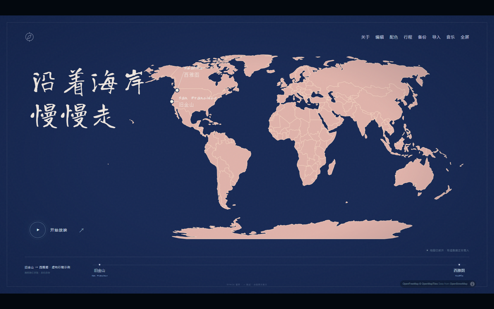
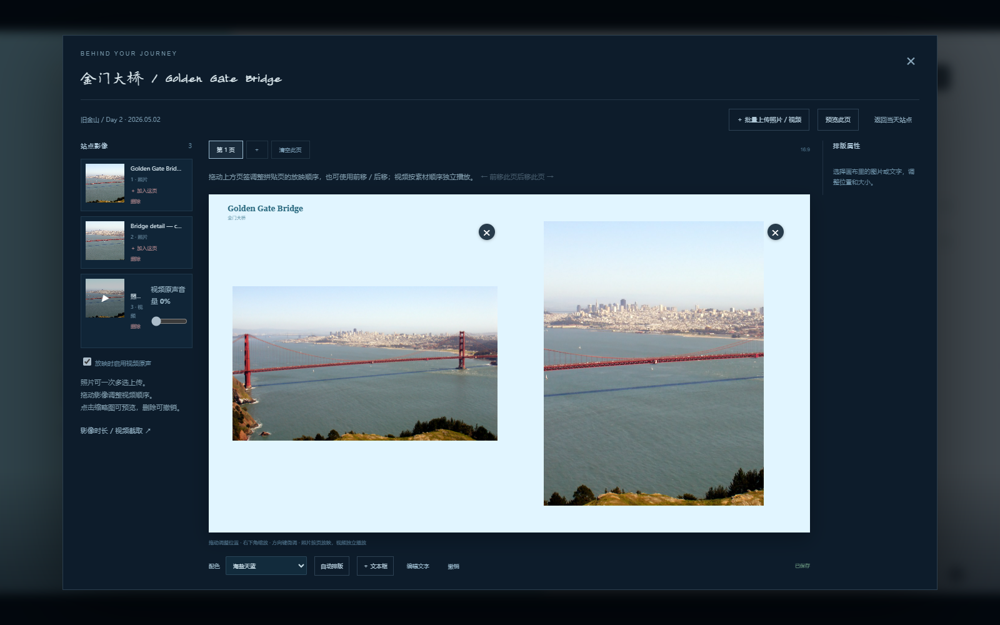

# 旅行手账 / Travel Journal

**一句话，把旅行素材变成一份可以播放、编辑和带走的地图手账。**

给 AI 一份行程、一个照片文件夹和几段日记，它会调用模板生成完整网站。你也可以先只给行程，在网页里慢慢加入照片和视频。



## 可以怎么用

```text
使用 $travel-journal，把我的加州三日游行程、photos 文件夹和这些日记做成旅行手账。
用浅蓝色，保留我的原文，生成后帮我打开本地预览。
```

```text
使用 $travel-journal，继续修改这份手账。
这是 journal.source.json 和新增照片，把第二天的行程补进去，保留其他内容。
```

```text
使用 $travel-journal，先用自带的公开示例做一份演示，我想体验放映、照片排版和备份。
```

适合旅行回忆、交换生活记录和个人游记。它生成交互网站；MP4 导出、旅行预订和小红书图文生成暂未包含。

## 安装到 Codex

下载或克隆本仓库，将**完整的 `skills/travel-journal` 文件夹**放到以下任一位置：

- 当前项目：`.agents/skills/travel-journal/`
- 当前用户的所有项目：`~/.agents/skills/travel-journal/`

PowerShell 示例，在下载的仓库根目录运行：

```powershell
$skillDestination = Join-Path $HOME '.agents/skills/travel-journal'
if (Test-Path -LiteralPath $skillDestination) { throw '目标已存在，请先检查已有版本' }
New-Item -ItemType Directory -Force -Path (Split-Path $skillDestination) | Out-Null
Copy-Item -LiteralPath './skills/travel-journal' -Destination $skillDestination -Recurse
```

macOS / Linux：

```sh
mkdir -p ~/.agents/skills
test ! -e ~/.agents/skills/travel-journal && cp -R skills/travel-journal ~/.agents/skills/
```

然后在 Codex 中输入 `$travel-journal`。如果没有出现，重新打开会话。其他支持 `SKILL.md` 的代理可使用同一份文件夹；自动发现与执行权限取决于宿主。

安装目录和调用方式依据 [OpenAI 官方 Skills 文档](https://learn.chatgpt.com/docs/build-skills)。完整模板放在 Skill 内，安装后不依赖原仓库的 `dist/` 目录。

## 先直接运行示例

需要 **Node.js 20 或更新版本**，无需 npm 安装或 API Key。以下命令在仓库根目录运行：

```sh
node skills/travel-journal/scripts/build-journal.mjs --input skills/travel-journal/examples/coastal-weekend.json --output outputs/my-first-journal
node skills/travel-journal/scripts/serve.mjs --directory outputs/my-first-journal --port 8000
```

打开 **http://127.0.0.1:8000**。首次构建会从公开演示站下载约 20 MB 的字体、地图组件和示例素材，逐项校验 SHA-256；用户照片和文字不会发送到该站。街道地图和全球城市搜索仍需要网络。已有完整素材缓存时可添加 `--asset-cache <包含-assets-的网页目录>`。

想替换成自己的内容，交给 AI 按 [输入格式](references/input-format.md) 生成 JSON，或自行修改示例。示例使用虚构行程和有署名的公开素材，不代表作者的实际足迹。

## 生成后能做什么

- 世界地图目录、城市定位、按天组织站点和路线示意。
- 连续手写文字、照片拼贴、视频播放和自选配乐。
- 批量上传照片/视频，拖动排版、修改文字、调整页面顺序、删除和撤销。
- 在浏览器保存编辑，完整 JSON 备份、恢复，以及手机手账合并导入。
- 给每份手账独立的浏览器保存空间；更新生成版本时先保留浏览器编辑，再由你选择应用新版本。



输出目录包含 `index.html`、完整运行素材、`journal.source.json` 和 `START-HERE.txt`。生成器拒绝覆盖已有内容，请将更新版本生成到新目录。

浏览器编辑保存在该浏览器的本地存储；`journal.source.json` 记录生成时的内容。转移设备或重新生成前，请从网页的**备份**菜单导出完整 JSON。更换端口、域名、浏览器或设备会使用不同的本地存储。网站不会自动同步云端，也不会将你的新增照片写回原文件夹。

手机可以打开和编辑，放映沿用 16:9 画面，建议横屏。图片和视频会原样复制，HEIC 需要先转为 JPEG，MOV 的可播放性取决于浏览器编码支持。路线连接提供的坐标点，不提供道路导航。公开托管输出目录会公开其中的照片和文字。

## 验证

```sh
node --test tests/travel-journal.test.mjs
node skills/travel-journal/scripts/build-journal.mjs --input skills/travel-journal/examples/coastal-weekend.json --check
```

完整构建测试可通过 `TRAVEL_JOURNAL_ASSET_CACHE` 指向已生成网页目录启用。`tests/browser-smoke.cjs` 是可选的 Playwright + Chrome 浏览器测试，覆盖播放、编辑保存、备份恢复和版本切换，不是运行 Skill 的依赖。

本次打包保留仓库原有的应用代码授权说明；截图使用公开示例素材，来源见 [素材署名](assets/template/CREDITS.md)。第三方照片、音乐、字体和地图组件各自的署名与许可证随生成网站保留在 `CREDITS.md` 和 `assets/` 中。
